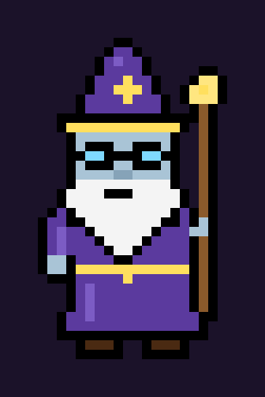
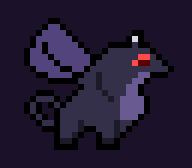
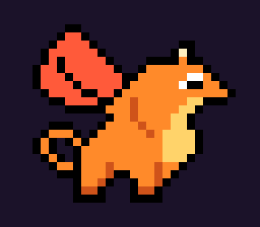
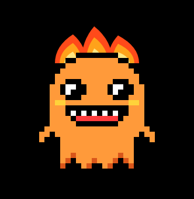
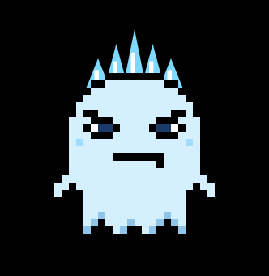
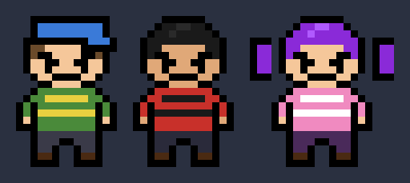

# PERDIDO — fangame de Undertale (mobile)

Jogo 2D estilo Undertale para Android. Feito em HTML5 Canvas, empacotado em APK (WebView).

## Baixar e instalar

1. Baixe [`apk/Perdido.apk`](apk/Perdido.apk) no celular.
2. Abra o arquivo e permita "instalar apps desconhecidos".
3. Jogue na horizontal.

Também dá para jogar no navegador: abra `www/index.html`.

## Controles

| Ação | Toque | Teclado |
|---|---|---|
| Andar / mover menus | Analógico (ou direcional) | Setas / WASD |
| Confirmar / falar | **A** ou tocar na tela | Z / Enter |
| Cancelar / menu | **B** ou "voltar" do Android | X / Esc |
| Mover a ALMA na batalha | Analógico ou arrastar o dedo | Setas |

Em **CONFIGURAÇÕES** (tela inicial ou menu B) dá para trocar entre **analógico** e **direcional**, e ligar/desligar música e efeitos.

## Fase 1 — O Labirinto

- **Cutscene**: você passeia pela floresta, se perde e cai num buraco.
- **Instrutor**: velho mago-monstro que te acolhe, ensina a lutar e entra no seu grupo.
- **Tutorial**: batalha contra o Boneco (LUTAR, AGIR, ITEM, POUPAR e desviar).
- **Labirinto gerado**: corredores com musgo e encontros aleatórios.
- **Monstros**: Musgolho e Fantasminha. Dá para matar ou poupar.
- **Ajuda do Instrutor** (AGIR): `Instr: Magia` (dano) e `Instr: Acalmar` (piedade). Ele cura você se o HP ficar baixo.
- **Estrela de salvamento**, Torta de Canela, item secreto e porta da saída.
- Final da fase mostra a rota (Pacifista / Neutra / Genocida).

## Fase 2 — DragonCity

- O Instrutor te leva até **DragonCity**, a cidade dos dragões.
- No **Ninho** você escolhe seu parceiro:
  - **Dragão Preto** (forte): +3 de ataque e *Investida* devastadora.
  - **Dragão Branco** (rápido): alma mais veloz e *Ventania*, que encurta o ataque inimigo.
  - **Dragão Laranja** (fogo): *Sopro de Fogo* que queima o inimigo por 3 turnos.
- O dragão só aparece nas batalhas (AGIR → Dragão). O Instrutor volta para o labirinto.
- **Cutscene dos irmãos fantasmas**: você se esconde atrás das caixas e vê o **FireGhost** (piadas péssimas) e o **IceGhost** (caçador de humanos) conversando.
- Cidade grande: praça com fonte, mercado da Dona Escama (loja), dragões moradores, missão do filhote perdido *Pipoca*.
- **Bosque das Cinzas** com encontros (Brasinha e Gelinho) e o quebra-cabeça das estátuas para criar a ponte sobre o rio de lava.
- **Casinha do Rio**: um fantasma chega de fininho, te assusta e começa a **BOSS FIGHT contra o FireGhost** (7 ataques diferentes, inclusive piadas que viram projéteis). Dá para vencer ou poupar rindo das piadas.

Músicas novas com vários instrumentos (sino, piano, flauta, cordas, metais, pizzicato, marimba, baixo, bateria e reverb), uma para cada área.

## Fase 3 — Colônia de Gelo

- **Cutscene**: enquanto você lutava na casinha, o **IceGhost** estava na colônia. Ele encontra o irmão (cinzas, ou desmaiado se você poupou) e jura **VINGANÇA**.
- Um **estranho encapuzado** te entrega um **CELULAR** e some na neve.
- O celular toca: é o **TREINADOR** (seu ex-Instrutor). Ele conta que o IceGhost levou o FireGhost pra casa (fantasma não morre!) e que os irmãos, estressados, encheram a colônia de armadilhas.
- **CELULAR** no menu B: ligue pro Treinador para pedir dicas (muda conforme o progresso). Tem também um número misterioso...
- Vila dos pinguins, Quiosque do Pinguim (loja) e moradores.
- Longa e chata de propósito:
  1. **Placas X/O**: transforme todo X em O sem pisar duas vezes.
  2. **Lago escorregadio**: só para quando bate em algo (solução de 10 movimentos).
  3. **Corredor das estalactites**: fuja das sombras.
  4. **Campo de neve funda** com encontros (Pinguim Bravo, Nevoso, Gelinho).
  5. **Blocos de gelo** até os botões.
  6. **Porta das Piadas** do FireGhost: errou, alçapão!
  7. **Ponte de gelo rachado**: siga as pegadas de pinguim ou SPLASH.
- No fim, a **casa de gelo dos irmãos fantasmas**... continua na Fase 4.

## Fase 4 — A Cidade Futurista

- Os irmãos fantasmas preparam a vingança "gelada": um **ESCORREGADOR** que te joga lá embaixo, na **Cidade Futurista**.
- Você conhece o **BIT**, um robô que te mostra a cidade com uma setinha de tour: **Holograma**, **Lanchonete**, **Mirante** (vista da cidade) e **Cinema** (filme *O Robô Pato contra os Pombos do Espaço*).
- À noite você dorme na casa do Bit. No dia seguinte: **ESCOLA**. O Bit é o único robô; o resto são crianças humanas que caíram lá.
- **Defender o Bit** dos valentões (Zé Marreta e Teca) e **ajudar ele a estudar**: na aula da Professora Volt você sussurra as respostas de "Sentimentos Humanos".
- **BOSS FIGHT: Gangue dos Valentões** (Brutão, Teca e Zé) contra você, seu dragão e o Bit.
  - **Bit: Música** cura HP de acordo com o seu nível (6 + 4×LV).
  - Ataques que miram no Bit: bloqueie com a ALMA, senão a bateria dele acaba.
  - Dá para convencê-los (Conversar, Defender, Mostrar amizade) ou vencer (eles fogem; ninguém morre).
- No fim, você pega o **contato do Bit** (CELULAR → Bit) e vocês se despedem.

Fase 5: em breve.

## Personagens

| Instrutor | Jogador |
|---|---|
|  |  |

| Musgolho | Fantasminha | Boneco |
|---|---|---|
|  |  |  |

| Dragão Preto | Dragão Branco | Dragão Laranja |
|---|---|---|
|  |  |  |

| FireGhost | IceGhost |
|---|---|
|  |  |

| Encapuzado | Pinguim Bravo | Nevoso |
|---|---|---|
|  |  |  |

| Bit | Valentões (Zé, Brutão, Teca) |
|---|---|
|  |  |

Toda a arte é pixel art original, desenhada em código (`www/js/sprites.js`).

## Estrutura

```
www/            jogo (HTML5)
  js/sprites.js   pixel art e tiles (fase 1)
  js/sprites2.js  dragões, fantasmas e tiles de DragonCity
  js/sprites3.js  neve, pinguins, boneco de neve, encapuzado
  js/sprites4.js  robôs, crianças, valentões, drones, tiles neon
  js/audio.js     efeitos e sequenciador de músicas (WebAudio)
  js/engine.js    controles, configurações, texto, diálogo, save
  js/battle.js    batalha, dragões, chefe e ataques
  js/world.js     motor do mundo (mapa, movimento, roteiros)
  js/phase1.js    Fase 1: O Labirinto
  js/phase2.js    Fase 2: DragonCity
  js/phase3.js    Fase 3: Colônia de Gelo (puzzles, armadilhas, celular)
  js/phase4.js    Fase 4: Cidade Futurista (Bit, cinema, escola, valentões)
  js/main.js      título, cutscene, cartões de fase, game over, final
android/        projeto Android (WebView) que gera o APK
apk/            APK pronto
```

## Compilar o APK

```bash
cd android
./gradlew assembleRelease
# saída: app/build/outputs/apk/release/app-release.apk
```

O GitHub Actions (`.github/workflows/perdido-apk.yml`) também gera o APK a cada push.

Fontes: VT323 e Press Start 2P (SIL Open Font License).
Undertale pertence a Toby Fox. Este é um projeto de fã, sem fins comerciais.
