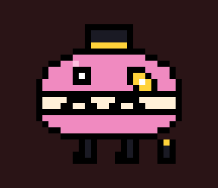
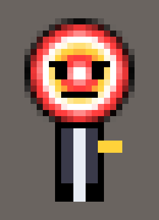
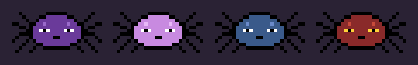
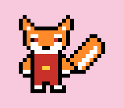
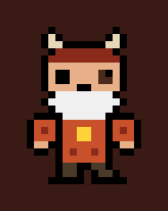
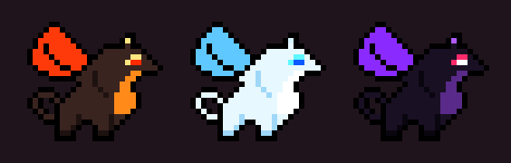

# PERDIDO — fangame de Undertale (mobile)

Jogo 2D estilo Undertale para Android. Feito em HTML5 Canvas, empacotado em APK (WebView).

## Baixar e instalar

1. Baixe [`apk/Perdido.apk`](apk/Perdido.apk) no celular.
2. Abra o arquivo e permita "instalar apps desconhecidos".
3. Jogue na horizontal.

Também dá para jogar no navegador: abra `www/index.html`.

## Controles

| Ação | Toque | Teclado |
|---|---|---|
| Andar / mover menus | Analógico (ou direcional) | Setas / WASD |
| Confirmar / falar | **A** ou tocar na tela | Z / Enter |
| Cancelar / menu | **B** ou "voltar" do Android | X / Esc |
| Mover a ALMA na batalha | Analógico ou arrastar o dedo | Setas |

Em **CONFIGURAÇÕES** (tela inicial ou menu B) dá para trocar entre **analógico** e **direcional**, e ligar/desligar música, efeitos e o painel de missões.

**Missões**: o objetivo atual aparece no canto da tela, com uma **seta amarela** apontando para onde ir. Também dá para ver em **menu B → MISSÃO**.

## Fase 1 — O Labirinto

- **Cutscene**: você passeia pela floresta, se perde e cai num buraco.
- **Instrutor**: velho mago-monstro que te acolhe, ensina a lutar e entra no seu grupo.
- **Tutorial**: batalha contra o Boneco (LUTAR, AGIR, ITEM, POUPAR e desviar).
- **Labirinto gerado**: corredores com musgo e encontros aleatórios.
- **Monstros**: Musgolho e Fantasminha. Dá para matar ou poupar.
- **Ajuda do Instrutor** (AGIR): `Instr: Magia` (dano) e `Instr: Acalmar` (piedade). Ele cura você se o HP ficar baixo.
- **Estrela de salvamento**, Torta de Canela, item secreto e porta da saída.
- Final da fase mostra a rota (Pacifista / Neutra / Genocida).

## Fase 2 — DragonCity

- O Instrutor te leva até **DragonCity**, a cidade dos dragões.
- No **Ninho** você escolhe seu parceiro:
  - **Dragão Preto** (forte): +3 de ataque e *Investida* devastadora.
  - **Dragão Branco** (rápido): alma mais veloz e *Ventania*, que encurta o ataque inimigo.
  - **Dragão Laranja** (fogo): *Sopro de Fogo* que queima o inimigo por 3 turnos.
- O dragão só aparece nas batalhas (AGIR → Dragão). O Instrutor volta para o labirinto.
- **Cutscene dos irmãos fantasmas**: você se esconde atrás das caixas e vê o **FireGhost** (piadas péssimas) e o **IceGhost** (caçador de humanos) conversando.
- Cidade grande: praça com fonte, mercado da Dona Escama (loja), dragões moradores, missão do filhote perdido *Pipoca*.
- **Bosque das Cinzas** com encontros (Brasinha e Gelinho) e o quebra-cabeça das estátuas para criar a ponte sobre o rio de lava.
- **Casinha do Rio**: um fantasma chega de fininho, te assusta e começa a **BOSS FIGHT contra o FireGhost** (7 ataques diferentes, inclusive piadas que viram projéteis). Dá para vencer ou poupar rindo das piadas.

Músicas novas com vários instrumentos (sino, piano, flauta, cordas, metais, pizzicato, marimba, baixo, bateria e reverb), uma para cada área.

## Fase 3 — Colônia de Gelo

- **Cutscene**: enquanto você lutava na casinha, o **IceGhost** estava na colônia. Ele encontra o irmão (cinzas, ou desmaiado se você poupou) e jura **VINGANÇA**.
- Um **estranho encapuzado** te entrega um **CELULAR** e some na neve.
- O celular toca: é o **TREINADOR** (seu ex-Instrutor). Ele conta que o IceGhost levou o FireGhost pra casa (fantasma não morre!) e que os irmãos, estressados, encheram a colônia de armadilhas.
- **CELULAR** no menu B: ligue pro Treinador para pedir dicas (muda conforme o progresso). Tem também um número misterioso...
- Vila dos pinguins, Quiosque do Pinguim (loja) e moradores.
- Longa e chata de propósito:
  1. **Placas X/O**: transforme todo X em O sem pisar duas vezes.
  2. **Lago escorregadio**: só para quando bate em algo (solução de 10 movimentos).
  3. **Corredor das estalactites**: fuja das sombras.
  4. **Campo de neve funda** com encontros (Pinguim Bravo, Nevoso, Gelinho).
  5. **Blocos de gelo** até os botões.
  6. **Porta das Piadas** do FireGhost: errou, alçapão!
  7. **Ponte de gelo rachado**: siga as pegadas de pinguim ou SPLASH.
- No fim, a **casa de gelo dos irmãos fantasmas**... continua na Fase 4.

## Fase 4 — A Cidade Futurista

- Os irmãos fantasmas preparam a vingança "gelada": um **ESCORREGADOR** que te joga lá embaixo, na **Cidade Futurista**.
- Você conhece o **BIT**, um robô que te mostra a cidade com uma setinha de tour: **Holograma**, **Lanchonete**, **Mirante** (vista da cidade) e **Cinema** (filme *O Robô Pato contra os Pombos do Espaço*).
- À noite você dorme na casa do Bit. No dia seguinte: **ESCOLA**. O Bit é o único robô; o resto são crianças humanas que caíram lá.
- **Defender o Bit** dos valentões (Zé Marreta e Teca) e **ajudar ele a estudar**: na aula da Professora Volt você sussurra as respostas de "Sentimentos Humanos".
- **BOSS FIGHT: Gangue dos Valentões** (Brutão, Teca e Zé) contra você, seu dragão e o Bit.
  - **Bit: Música** cura HP de acordo com o seu nível (6 + 4×LV).
  - Ataques que miram no Bit: bloqueie com a ALMA, senão a bateria dele acaba.
  - Dá para convencê-los (Conversar, Defender, Mostrar amizade) ou vencer (eles fogem; ninguém morre).
- No fim, você pega o **contato do Bit** (CELULAR → Bit) e vocês se despedem.

## Fase 5 — A Ilha dos Doces

> Esta fase é uma crítica ao nazismo. Ela mostra, sem violência gráfica, como a propaganda de "raça superior", a desumanização e a obediência cega levam à opressão — e como solidariedade e resistência podem vencer. Termina com um cartão de **memória** sobre o que aconteceu de verdade.

- **Cutscene**: os irmãos fantasmas te atacam por vingança com uma TEMPESTADE DE GELO.
- Você acorda num **hospital da Ilha dos Doces** e conhece a enfermeira **Marshmallow** e o jovem guarda **Chocolate**.
- Na ilha, os doces se dizem um "povo perfeito". Não-doces (robôs, humanos, fantasmas) são levados ao **campo de trabalho**.
- No campo: seu nome vira o **Nº 4812**, seu celular é confiscado, você usa uniforme cinza e **não pode falar com doces** (3 advertências = solitária).
- **FOME** (barra no canto): diminui com o tempo e mais rápido carregando peso; com pouca fome você anda devagar e pode desmaiar.
- Desafios: **construir uma casa** carregando blocos de açúcar (onde você nunca poderá entrar), **sopa rala** (dá para dividir com a Lia), **chamada** com tempo, **fábrica** (minijogo de embalar doces).
- Prisioneiros: **Vovó Fantasma**, **Ferrugem** (robô) e **Lia** (humana).
- Defender o Ferrugem do **Capataz Pirulito**, ir para a solitária, receber ajuda da Marshmallow, conseguir o **alicate** e o **mapa das rondas**, **fugir à noite** desviando das lanternas dos guardas e convencer o Chocolate a te deixar ir.
- Do lado de fora tem sinal: você chama o **Treinador**, o **Bit** e seu **dragão**, liberta o campo e enfrenta o **BOSS: Diretor Macaron Dourado** com os três ao seu lado.
  - Não dá para poupá-lo: ele precisa ser detido. Ações como **Recusar obedecer** e **Lembrar das vítimas** derrubam a defesa dele.
  - No fim ele é preso para ser **julgado**, e todos recuperam seus **nomes**.

## Rotas

O jogo conta quantos monstros você **poupou** e quantos **derrotou**:

- **Pacifista**: nenhum derrotado.
- **Genocida**: 6 ou mais derrotados e no máximo 2 poupados.
- **Neutra**: qualquer outro caso.

A rota muda o final das Fases 6 e 7.

## Fase 6 — A Caverna

- Você se despede do Treinador, do Bit, da Marshmallow, do Chocolate e da Lia e desce cada vez mais fundo.
- **Vila das Teias** (aranhas: a Tecelã e os filhotes Fio e Novelo) e **Cidade dos Ossos** (esqueletos: Mestre Osso e Fêmur Jr.), vizinhos há cem anos.
- No Grande Salão, os **irmãos fantasmas** aparecem: "como você ainda está vivo?". Eles chamam todos os vilões, espalham mentiras e começam uma **nova era de caos**: aranhas contra esqueletos. Mães perdem filhos e filhos perdem mães.
- Com a guerra, aparecem **soldados aranha** e **soldados esqueleto** pelo caminho.
- Na **Toca Escura** você os confronta: "isso acabou, ponto final".
  - **Pacifista**: sem vingança, só conversa. Vocês podem virar **amigos**.
  - **Neutra**: **BOSS** contra os dois irmãos; eles são detidos, mas não viram amigos.
  - **Genocida**: **BOSS** e depois um **ritual** que acaba com os dois fantasmas.
- Depois... **nada mudou**. A guerra continua. Aranhas e esqueletos te pedem para achar a cidade lá no fundo.

## Fase 7 — Neo-Sakura

- Uma cidade enorme parecida com Tóquio: cerejeiras, neon, lanternas, torii e trens.
- Os moradores não querem os refugiados. A **Guardiã Kitsune** decide:
  - **Genocida**: ela olha nos seus olhos e deixa todos entrarem, com medo.
  - **Neutra**: batalha contra a Kitsune.
  - **Pacifista**: ela vê seu lado fofo e humilde e aceita todos.
- Você vive lá por um bom tempo: **escola** (quiz de japonês), **konbini** (onigiri, mochi, ramen), o reencontro do **Novelo** com a mãe (salvo por esqueletos) e o **Festival das Lanternas**.
- Meses depois, a **guerra chega**. Você tenta parar, mas é impossível: você não muda o mundo.
- Você se culpa por ter conhecido os fantasmas. Se eles são seus amigos, terminam a amizade e vão embora; se só estão vivos, vão para longe; se não existem mais, não sobra ninguém para culpar.
- A cidade é destruída pedaço por pedaço: **fuja até o metrô** antes do tempo acabar, desviando dos escombros.

## Fase 8 — A Vila Vulcânica

- O trem de Neo-Sakura chega à **Vila Brasa**, onde moram **golens de lava** e **fantasmas de lava**. Todo mundo da cidade veio junto.
- A vila fica aos pés do **Gigante Adormecido**, um vulcão gigante que está descansando.
- O **Mestre Draco**, treinador de dragões, treina o seu dragão em 3 lições:
  1. **Pontaria**: aperte A quando a agulha estiver na faixa verde.
  2. **Voo**: monte no dragão e passe pelos buracos das rochas.
  3. **Prova final**: batalha contra o **Dragão Ancião** (impressione e poupe).
  - Cada lição aumenta o dano do ataque do dragão (+4).
- Subida do vulcão: **campo de gêiseres** (explodem em ondas), **lago de lava** com pedras que afundam e trilha até o topo.
- No topo está o **Coração do Vulcão**, que faz o dragão evoluir:
  - Laranja → **Dragão de Lava**: muito mais dano, e a queima dura mais e machuca mais.
  - Branco → **Dragão de Neve**: muito mais rápido e **congela** o inimigo por 1 ataque.
  - Preto → **Dragão das Trevas**: um golpe com dano altíssimo.
- O Gigante acorda, o caminho desmorona e o dragão, que aprendeu a voar, te leva embora voando.

Fase 9: em breve.

## Personagens

| Instrutor | Jogador |
|---|---|
|  |  |

| Musgolho | Fantasminha | Boneco |
|---|---|---|
|  |  |  |

| Dragão Preto | Dragão Branco | Dragão Laranja |
|---|---|---|
|  |  |  |

| FireGhost | IceGhost |
|---|---|
|  |  |

| Encapuzado | Pinguim Bravo | Nevoso |
|---|---|---|
|  |  |  |

| Bit | Valentões (Zé, Brutão, Teca) |
|---|---|
|  |  |

| Diretor Macaron | Marshmallow e Chocolate | Capataz Pirulito | Lia, Ferrugem e Vovó Fantasma |
|---|---|---|---|
|  |  |  |  |

| Aranhas | Esqueletos | Guardiã Kitsune |
|---|---|---|
|  |  |  |

| Mestre Draco | Golem e Fantasma de Lava | Dragões evoluídos (Lava, Neve, Trevas) |
|---|---|---|
|  |  |  |

Toda a arte é pixel art original, desenhada em código (`www/js/sprites.js`).

## Estrutura

```
www/            jogo (HTML5)
  js/sprites.js   pixel art e tiles (fase 1)
  js/sprites2.js  dragões, fantasmas e tiles de DragonCity
  js/sprites3.js  neve, pinguins, boneco de neve, encapuzado
  js/sprites4.js  robôs, crianças, valentões, drones, tiles neon
  js/sprites5.js  doces, prisioneiros, uniforme, tiles da ilha e do campo
  js/sprites6.js  aranhas, esqueletos, kitsune, tiles da caverna e de Neo-Sakura
  js/sprites7.js  golens e fantasmas de lava, Mestre Draco, dragões evoluídos, tiles do vulcão
  js/audio.js     efeitos e sequenciador de músicas (WebAudio)
  js/engine.js    controles, configurações, texto, diálogo, save
  js/battle.js    batalha, dragões, chefe e ataques
  js/world.js     motor do mundo (mapa, movimento, roteiros)
  js/phase1.js    Fase 1: O Labirinto
  js/phase2.js    Fase 2: DragonCity
  js/phase3.js    Fase 3: Colônia de Gelo (puzzles, armadilhas, celular)
  js/phase4.js    Fase 4: Cidade Futurista (Bit, cinema, escola, valentões)
  js/phase5.js    Fase 5: Ilha dos Doces (campo, fome, fuga, libertação)
  js/phase6.js    Fase 6: A Caverna (aranhas, esqueletos, guerra, irmãos fantasmas)
  js/phase7.js    Fase 7: Neo-Sakura (refugiados, escola, festival, guerra, fuga)
  js/phase8.js    Fase 8: Vila Vulcânica (treino do dragão, vulcão, evolução, voo)
  js/quests.js    painel de missões e seta de objetivo de todas as fases
  js/main.js      título, cutscene, cartões de fase, game over, final
android/        projeto Android (WebView) que gera o APK
apk/            APK pronto
```

## Compilar o APK

```bash
cd android
./gradlew assembleRelease
# saída: app/build/outputs/apk/release/app-release.apk
```

O GitHub Actions (`.github/workflows/perdido-apk.yml`) também gera o APK a cada push.

Fontes: VT323 e Press Start 2P (SIL Open Font License).
Undertale pertence a Toby Fox. Este é um projeto de fã, sem fins comerciais.
